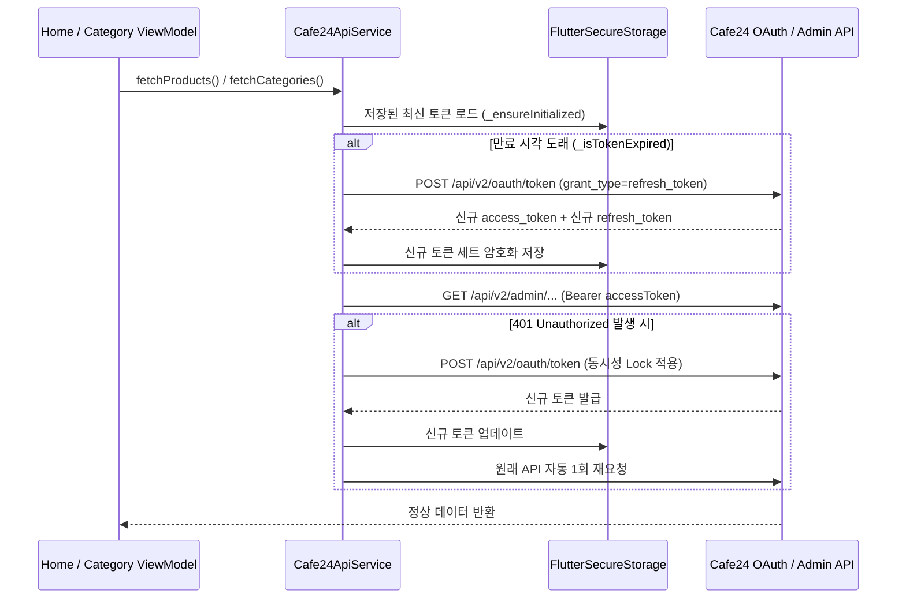

# 📝 작업 일지 & 토큰 자동 갱신·카테고리 탭 연동 보고서 (2026-10-16)

## 📌 작업 개요
본 문서는 2026년 10월 16일에 진행된 **카테고리 탭(`lib/views/category.dart`)의 실시간 대·중분류 및 상품 완벽 연동**과 **Cafe24 OAuth 2.0 토큰 만료(`401 invalid_token`) 해결을 위한 자동 리프레시 시스템 구축 작업**을 정리한 보고서입니다.

---

## 🛠 주요 작업 내역 요약

| 구분 | 주요 변경 사항 | 파일 위치 |
| :--- | :--- | :--- |
| **카테고리 탭 전면 연동** | Cafe24 대분류(Depth 2) 사이드바, 중분류(Depth 3) 그리드, 실시간 상품 필터링 및 썸네일 연동 | `lib/views/category.dart` <br> `lib/models/product.dart` |
| **선제적 토큰 만료 감지** | `CAFE24_EXPIRES_AT` 기준 만료 1분 전 감지 및 API 요청 전 자동 리프레시 | `lib/services/cafe24_api_service.dart` |
| **401 에러 자동 재시도** | API 호출 중 `401 Unauthorized` 발생 시 `refreshAccessToken()` 후 즉시 1회 자동 재요청 | `lib/services/cafe24_api_service.dart` |
| **동시성 제어 (Lock)** | 다중 Provider 동시 호출 시 `refresh_token` 중복 사용 방지를 위한 `_refreshFuture` 공유 | `lib/services/cafe24_api_service.dart` |
| **토큰 영구 저장소 연동** | 갱신(Rotation)된 `access_token` 및 `refresh_token`을 `FlutterSecureStorage`에 영구 보존 | `lib/services/cafe24_api_service.dart` |

---

## 🔄 1. Cafe24 OAuth 토큰 자동 리프레시 아키텍처

Cafe24의 `access_token` 유효기간은 **2시간**이며, `refresh_token` 유효기간은 **2주**입니다. 특히 리프레시 요청 시 기존 `refresh_token`이 폐기되고 **새로운 `refresh_token`이 함께 발급(Token Rotation)**되므로 동시성 제어와 기기 내 영구 저장이 필수적입니다.



### 🔑 핵심 코드: 동시성 제어 및 401 자동 재요청 (`lib/services/cafe24_api_service.dart`)

```dart
/// Refresh Token을 사용하여 새로운 Access Token & Refresh Token 발급 (동시성 제어 포함)
Future<bool> refreshAccessToken() {
  if (_refreshFuture != null) {
    return _refreshFuture!;
  }
  _refreshFuture = _performTokenRefresh().whenComplete(() {
    _refreshFuture = null;
  });
  return _refreshFuture!;
}

/// 401 만료 에러 발생 시 자동으로 토큰 리프레시 후 1회 재요청하는 공통 GET 헬퍼
Future<Response<dynamic>> _getWithAutoRefresh(
  String url, {
  Map<String, dynamic>? queryParameters,
}) async {
  await _ensureValidToken();

  try {
    return await _dio.get(url, queryParameters: queryParameters, /* headers */);
  } on DioException catch (e) {
    if (e.response?.statusCode == 401 && refreshToken.isNotEmpty) {
      final refreshed = await refreshAccessToken();
      if (refreshed) {
        return await _dio.get(url, queryParameters: queryParameters, /* new headers */);
      }
    }
    rethrow;
  }
}
```

---

## 🗂 2. 카테고리 탭 실시간 데이터 연동 (`lib/views/category.dart`)

1. **좌측 사이드바 (Depth 2 대분류)**:
   - `전체보기`, `롤매트`, `현관발매트`, `인조잔디`, `청소용품`, `생활 주방용품`, `침구` 등 API에서 가져온 대분류를 표시하며, 각 카테고리에 맞춘 배너 컬러와 타이틀이 동적으로 변경됩니다.
2. **세부 카테고리 그리드 (Depth 3 중분류)**:
   - 선택된 대분류의 `id`를 `parentId`로 가지는 하위 중분류들을 자동으로 매핑합니다.
   - 세부 카테고리 카드를 터치하면 선택 상태가 활성화되며 하단 추천 상품 리스트가 즉시 해당 세부 카테고리로 필터링됩니다.
3. **실제 상품 이미지 및 상세 페이지 연결**:
   - `homeProductsProvider`의 실시간 상품을 표시하며, `Image.network`로 실제 상품 썸네일을 렌더링하고 클릭 시 `ProductPage`로 즉시 이동합니다.

---
*작성일자: 2026년 10월 16일*

